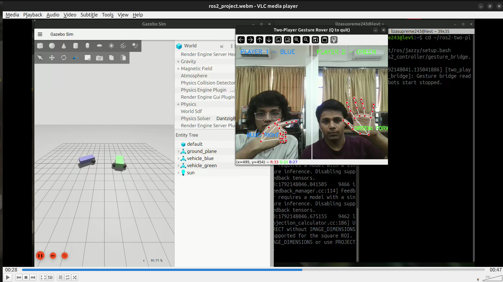

# Two-Player Webcam-Controlled Robots

A real-time robotics project that lets two players control separate differential-drive robots in a Gazebo simulation using hand gestures detected by a webcam.

## Features

- Real-time hand tracking using OpenCV and MediaPipe
- Rule-based gesture classification
- Two-player control using separate regions of the webcam frame
- UDP communication between the vision system and ROS 2 controller
- ROS 2 velocity commands for independent robot control
- Gazebo simulation with differential-drive robots
- Command timeout for safer control when gesture updates stop

## System Architecture

Webcam → MediaPipe Hand Tracking → Gesture Classification → UDP/JSON → ROS 2 Gesture Bridge → Gazebo Robots

## Technologies

- Python
- ROS 2 Jazzy
- Gazebo Sim
- OpenCV
- MediaPipe
- geometry_msgs/Twist
- UDP sockets and JSON

## Controls

| Gesture | Action |
|---|---|
| Open palm | Move forward |
| Closed fist | Stop |
| Index finger pointing left | Turn left |
| Index finger pointing right | Turn right |

The left half of the webcam view controls the blue robot, while the right half controls the green robot.

## Run the Project

### 1. Launch Gazebo

```bash
source /opt/ros/jazzy/setup.bash
ros2 launch ros_gz_sim_demos diff_drive.launch.py
```

### 2. Start the ROS 2 gesture bridge

```bash
cd ~/two-player-robot-control
source /opt/ros/jazzy/setup.bash
python3 ros2_controller/gesture_bridge.py
```

### 3. Start webcam tracking

Activate a Python virtual environment containing the project's dependencies, then run:

```bash
python vision/hand_tracking.py
```

## Demo

See `ros2_project.webm` for a demonstration of the project.

## Future Improvements

- More robust gesture recognition
- Gesture smoothing and calibration
- Improved multi-hand tracking
- Automated testing and ROS 2 launch integration

## License

See the repository license for permitted use and redistribution.
